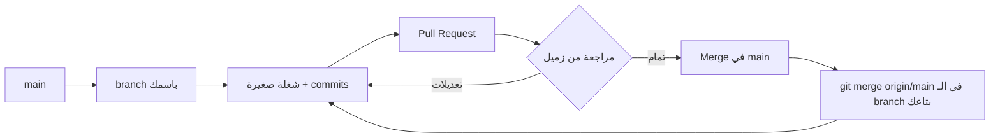

# دليل المساهمة (Contribution)

**القاعدة: كل واحد له branch باسمه، ومحدش بيعمل push على `main` مباشرة. كل شغلة صغيرة خلصت = Pull Request.**



---

## ١. أول مرة بس

```bash
git clone https://github.com/OsamaDevs/smart-appliance-scheduler-ga
cd smart-appliance-scheduler-ga
git config user.name "Your Name"
git config user.email "you@example.com"
```

## ٢. اعمل الـ branch بتاعك (باسمك)

```bash
git checkout main
git pull origin main
git checkout -b osama        # غيّر الاسم لاسمك
```

## ٣. احفظ شغلك (Commit)

```bash
git status
git add <file>
git commit -m "Add fitness function"
```

الرسالة قصيرة وتقول **إيه اللي اتغيّر**.

## ٤. ارفع شغلك

```bash
git push -u origin osama
```

## ٥. افتح Pull Request كل ما تخلّص شغلة صغيرة

الشغلة الصغيرة = دالة أو ميزة واحدة شغالة (غالبًا من ٣ لـ ٥ commits، أو يوم شغل). مش PR لكل commit، ومش PR واحد في الآخر.

على GitHub: **Compare & pull request** → اكتب وصف قصير → اطلب مراجعة من زميل → بعد الموافقة **Merge**.

## ٦. حدّث الـ branch بتاعك بعد كل Merge

```bash
git checkout osama
git fetch origin
git merge origin/main
```

لو ظهر **Conflict**: افتح الملف، دوّر على العلامات `<<<<<<<` و `=======` و `>>>>>>>`، سيب الكود الصح وامسح العلامات، وبعدين:

```bash
git add <file>
git commit
```

---

## مرجع سريع

| الهدف | الأمر |
|---|---|
| شوف التغييرات | `git status` / `git diff` |
| شوف التاريخ | `git log --oneline` |
| اعرض الـ branches | `git branch` |
| غيّر الـ branch | `git checkout <branch>` |
| الغي تعديل مش متحفظ | `git restore <file>` |
| الغي `add` | `git restore --staged <file>` |

## اعمل / متعملش

| اعمل | متعملش |
|---|---|
| `pull` من `main` قبل ما تبدأ كل يوم | `push` على `main` مباشرة |
| PR صغير ومحدد (شغلة واحدة) | PR ضخم فيه كل حاجة |
| راجع PR زميلك في نفس اليوم | `git push --force` |
| كل واحد يشتغل على ملفاته/كلاساته | تعدّل نفس الملف مع زميلك في نفس الوقت |
| استخدم `.gitignore` | ترفع ملفات مترجمة (`*.class`) أو مفاتيح سرية |